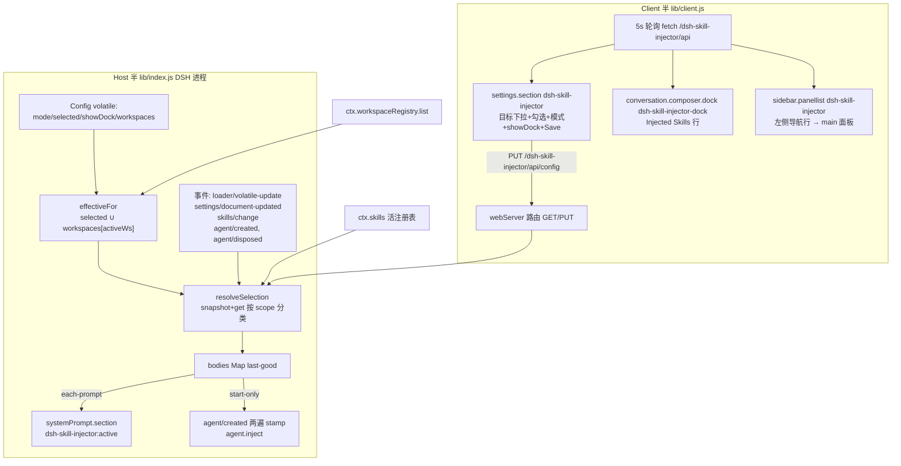

# dsh-skill-injector 设计文档

> 参考 `temp/skill-injector-plugin/`（v1.2.0）的同功能重构版。行为契约对齐原版，结构精简，全新命名空间。

## 项目类型

| 项 | 值 |
|---|---|
| 类型 | DeepSeek Harness (DSH) 打包 profile 插件（host + client 双半） |
| 平台 | DSH 0.2.x（`@deepseek-ai/dsh-skill` / `dsh-llm` 以 peer 声明 `>=0.2.0-rc.1 <0.3.0-0`） |
| 语言/运行时 | TypeScript → Node ESM（host）+ 浏览器 CJS ModuleLoader 闭包（client），Node ≥ 20 |
| 构建 | tsdown；包管理 pnpm（`nodeLinker: hoisted`）；`lib/` 三个产物提交进仓库 |
| 测试 | node:test 单文件 `tests/invariants.test.mjs`，关键不变量 21 条（9 helpers + 12 host） |
| CI/CD | 无（本地构建 + 手工验收） |

## 术语表

| 术语 | 含义 |
|---|---|
| 注入模式 `mode` | `each-prompt`（systemPrompt.section 每次请求重渲染）或 `start-only`（`agent/created` 时 `agent.inject()` 一条持久消息） |
| `selected` | 选中的 kebab-case 技能名数组，去重，上限 `MAX_SELECTED = 16` |
| `showDock` | 是否渲染 composer 下 dock 行，默认 true，仅 opt-out |
| 五态分类 | `ready` / `load-failed` / `unavailable`（discovery 未完成）/ `no-scope`（未 scoped）/ `unknown`（scoped+complete+目录中不存在，唯一终态失败） |
| last-good body | 瞬态失败时继续注入的上次成功加载的技能体（进程内 Map，不跨重启） |
| volatile Config | Loader 的 entry Config 四字段全 `.volatile()`：Save 原地提交（`loader/volatile-update`）而不重载 entry |
| 工作区追加 `workspaces` | `Record<workspaceId, string[]>`，只存追加项；会话 cwd 落在该工作区时与全局 `selected` 合并，全局优先、去重、合计仍受 `MAX_SELECTED` 约束 |
| 生效选择 `effective` | `mergeSelection(selected, workspaces[当前工作区])`；会话无匹配工作区时等于 `selected` |
| 两遍 stamp | `agent/created` 内 pass1 stamp 缓存已有 body；pass2 等待 resolve（deadline 3000ms）后补 stamp 冷缓存余量 |
| scope | 技能查找必须用 live agent 对象做 scope：`{ scope: agent, cwd: agent.session.header.cwd }`；host 全局层查不到 agent preset 的技能 |

## 身份与命名（全新命名空间，防两插件并存冲突）

| 项 | 原版 | 新版 |
|---|---|---|
| 包名 | `skill-injector-plugin` | `dsh-skill-injector` |
| API 路由 | `/skill-injector/api`、`/skill-injector/api/config` | `/dsh-skill-injector/api`、`/dsh-skill-injector/api/config` |
| section name | `skill-injector:active`（order 150） | `dsh-skill-injector:active`（order 150） |
| settings.section id | `skill-injector`（order 60） | `dsh-skill-injector`（order 60） |
| dock id | `skill-injector-dock`（order 10） | `dsh-skill-injector-dock`（order 10） |
| 侧边栏入口 id / 面板 key | 无 | `dsh-skill-injector`（`sidebar.panellist` order 10 + `main` keyed slot，两者必须同名） |
| CSS 前缀 | `si-` | `dsi-` |

路由路径必须换：`webServer.register` duplicate (kind,path) 会 throw。

## 架构



数据流（纯 pull）：client 5s 轮询 GET；host 按需读 `ctx.skills`；快照 `unresolved[]` 带每技能 reason；轮询即自动重试，设置页另有 Retry（立即重查）与 Remove（`canRemove` 为 true 才显示）。

## 文件格局

```
dsh-skill-injector/
├── src/index.ts          # host 半（现 790 行，原版 674；多出工作区合并与侧边栏数据）
├── src/helpers.ts        # 纯函数：validateSelection / mergeSelection / workspaceForCwd /
│                         #   escapePromptBraces / buildInjectionMessage / classifySelection /
│                         #   applyBodies / cachedSuffix / isSkillName / MAX_SELECTED
├── src/client/index.tsx  # client 半（现 734 行，原版 354；多出侧边栏入口、全局面板、分组与目标下拉）
├── lib/                  # 构建产物，已提交：index.js / helpers.js / client.js（无 source map）
├── tests/invariants.test.mjs         # 21 条行为契约（9 helpers + 12 host）
├── tests/fixtures/sample-skill.json  # ctx.skills.get 返回形状样例
├── cordis.patch.yml      # dsh.bundle.patch 插入插件行
├── tsdown.config.ts      # host(node ESM) + helpers + client(browser CJS)
├── package.json          # exports["./client"]、dsh.bundle、dsh.client(platform web)
├── README.md（中文为主）/ AGENTS.md（精简，记录 load-bearing 行为）/ LICENSE
```

砍掉原版的 `llms.txt`、`llms-full.txt`、`README.zh.md`、`HANDOFF-*.md`。

## 行为契约（= 测试清单，先红后绿）

**helpers 纯函数（9 条）**
1. `validateSelection`：合法通过并去重；>16 拒；非 kebab 拒；非法 mode 拒；`showDock` 缺省→true
2. `escapePromptBraces`：`{{` → `&#123;&#123;`（仅 section 路径用；start-only 消息不插值，保持原文）
3. `buildInjectionMessage` 返回 `{content:[{type:'text',text}], source:{kind:'skill-invocation',name,form:'instructions'}}`
4. `classifySelection` 五态语义（见术语表）；incomplete catalog / unscoped 永不产生 `unknown`
5. `applyBodies`：`ready` 换新、`unknown` 丢、瞬态保 last-good、取消选的丢
6. `cachedSuffix`：start-only 已注入→"already in this session"；start-only 未注入→"last loaded copy retained"；each-prompt→"still injecting the last loaded copy"；无缓存→''
7. `isSkillName` kebab-case 边界

**host smoke（9 条，stub ctx 参照原版 tests/host.test.mjs 形状）**

8. `Config` 四字段全 `.volatile()`（Save 不重载 entry 的前提），`workspaces` 默认 `{}`
9. `apply()` 注册两路由 + section；GET 返回 `{ok:true, mode, selected, effective, truncated, workspaces, activeWorkspaceId, available, unresolved, injected, canRemove, showDock}`；所有路径均 JSON
10. PUT 合法→`settings.update(entryId, patch)`→200 回显；非法→400 JSON；非 JSON→400；异常→500 JSON
11. 瞬态失败后 section 仍渲染 last-good body；`unknown` 后 body 从 section 消失
12. start-only 冷缓存两遍 stamp；resume（`ownEvents()` 已有 `skill-invocation`@name）不双 stamp
13. `canRemove` 仅在 scoped resolve 跑过后为 true（boot 竞态不出现 Remove）
14. `agent/disposed` 清记忆 scope；后续从 `agents.list()` 末位恢复
15. `injectedByAgent` 上限 200，驱逐最老
16. `loader/volatile-update` 触发 re-resolve（Save 即生效于下次装配）

**工作区与合并（后加 5 条，编号接上）**

17. `mergeSelection`：全局在前、追加在后、去重、超 `MAX_SELECTED` 截断并给出 `truncated`
18. 工作区追加进入 `effective`：会话 cwd 命中工作区时 `effective = selected ∪ workspaces[id]`，全局项仍在
19. `workspaceForCwd`：按最长前缀匹配，大小写与 `\`/`/` 归一；同级目录不误命中
20. 无 `workspaceRegistry`（可选服务缺失）时退回只用全局选择，不报错
21. PUT 持久化 `workspaces` 并剪掉 registry 中已不存在的 id；非字符串技能名 → 400

## 精简点（相对原版）

- **删 pre-0.2 兼容**：`historyEvents` 只走 `ownEvents()`（删 `snapshotEvents`/`events` 回退）；快照删 `missing` 遗留字段；`settings.configure({auto:false})` 直调（0.2.x 必有，仍 try/catch）
- **保留不动**（load-bearing）：volatile 四件套、scope 查找、两遍 stamp、in-flight memo（key = scoped/unscoped + workspaceId + effective selection）+ `passSeq` 单调守卫、`{{` 转义只在 section 路径、last-good Map、`ENTRY_ID` 从 `loader.entries()` 按 name 解析、`registerRoute` 吞重复注册异常
- **常量不变**：`MAX_SELECTED=16`、`POLL_MS=5000`、`STAMP_RESOLVE_DEADLINE_MS=3000`、tracked agents 上限 200、section order 150

## 关键逻辑伪代码（两遍 stamp）

```
on agent/created(agent):
  remember(agent)                       # scope 供 skills 查找
  stampSelected(agent)                  # pass1: 只 stamp 缓存已有 body
  if mode != start-only: return
  await withDeadline(resolveSelection(), 3000ms)   # pass2: 冷缓存等 resolve
  stampSelected(agent)                  # 幂等：已 stamp 的跳过

stampSelected(agent):
  for name in effectiveFor(config()):        # 全局 ∪ 当前工作区追加
    if stamped.has(name): continue
    if agent.session.ownEvents() 已有 user/message 且
       data.source.kind=='skill-invocation' 且 data.source.name==name:
      标记已 stamp; continue
    body = bodies.get(name); 无则跳过（下个边界再试）
    agent.inject(createUserMessage(buildInjectionMessage(name, renderSkillContent(body))))
```

边界：resolve 超 3s → 放弃 pass2，session 创建不被卡死；stamp 抛错 → 吞掉，不 fail `agent/created`（serial 事件，抛错会 fail 会话创建）。

## 边界场景

1. 首个 session 出现前 GET API → 无 scope：`available: []`、全选技能 `no-scope`、`canRemove: false`，UI 不显示 Remove
2. 会话进行中删除技能文件 → scoped+complete 读不到 → `unknown` → body 丢弃、UI 出 Remove；其余技能照常
3. provider 报错 / discovery 未完成 → `unavailable` / `load-failed` → last-good 继续注入
4. 重启后 start-only resume → `ownEvents()` 查到旧 stamp → 不双 stamp
5. 两插件并存 → 路由/ID/CSS 前缀全新命名空间，无 (kind,path) 冲突
6. 空 selected → 不注入，dock 显示 none，设置页正常
7. profile patch 无 config 块 → schemastery default 兜底 `{mode:'each-prompt', selected:[], showDock:true, workspaces:{}}`
8. 会话 cwd 落在某工作区内 → 注入该工作区的追加项（全局项仍在）；cwd 不在任何工作区 → 只用全局
9. 保存时某工作区已被删除 → 该 id 从 `workspaces` 中剪掉，其余工作区设置保留
10. 面板切到工作区目标时，全局已选项置灰不可取消（标 `global`），只编辑本工作区追加；底部按目标显示全局或工作区合并预览

## 错误处理总则

- 路由任何路径都写 JSON（200/400/500），永不非 JSON 500
- 所有事件监听与 stamp 单个失败被吞（contained），不拖垮 entry 或会话创建
- `resolveSelection` 去重：并发触发共享同一 pass；`passSeq` 保证晚到的旧 pass 不覆盖新 pass 的 bodies

## 实施约束

- 不复制技能文件进包；一切读 live `ctx.skills`
- client↔host 只走 HTTP（打包插件无 `harness.handle`/`host.call`）
- 安装方式：`dsh plugin --profile web add ./dsh-skill-injector` + 重启
